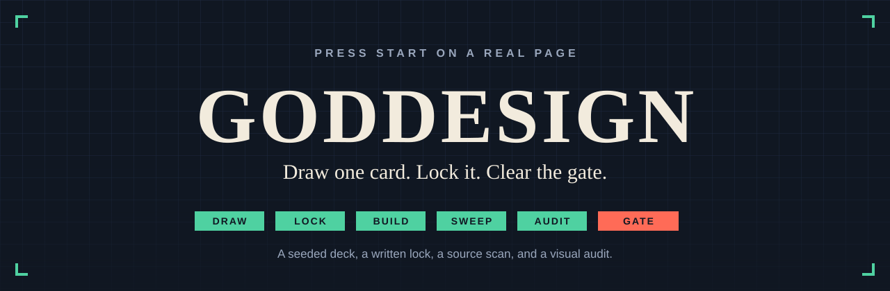
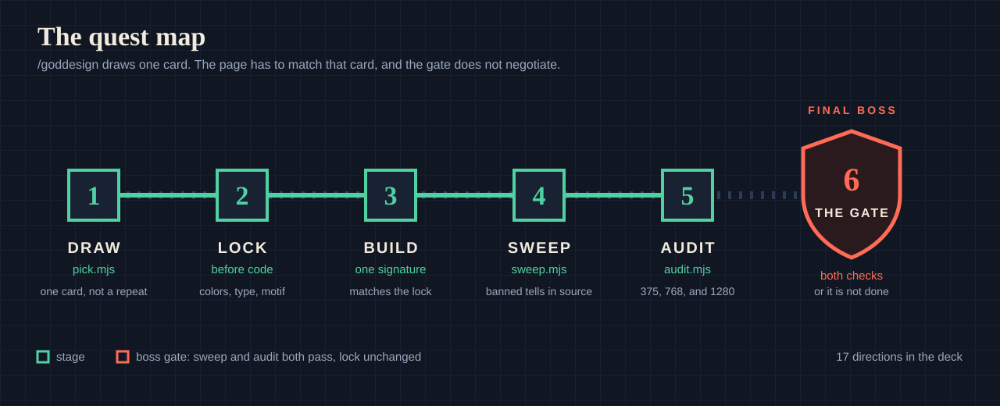
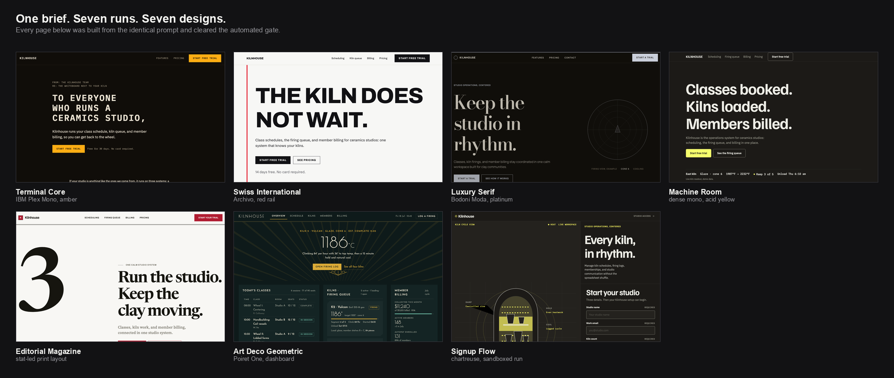

<p align="center">
  
</p>

[](https://www.npmjs.com/package/@hxp-tools/goddesign)
[](https://github.com/hannsxpeter/goddesigns/actions/workflows/ci.yml)
[](LICENSE)

Goddesign turns a page your coding agent builds into a quest with one rule:
the look is drawn, not invented on the spot. A script deals one direction from
a deck, writes that deal down before any code, and a gate measures the page
against it. The model does the designing. Goddesign adds the three things a
model cannot do for itself: pick at random, remember what you shipped last
time, and check the rendered page.

It is one skill. Ask for a page, a restyle, or a dashboard. A small edit gets
the rules and a source scan. A new page plays the full quest.

## Press start

```bash
npx @hxp-tools/goddesign --claude --global
```

The command you run is `goddesign`. Use `--codex` for Codex, `--cursor` for
Cursor, `--claude --codex` for both, or `--all` for every supported host.
`--local` installs into the current directory instead of your home directory.
Uninstall with `npx @hxp-tools/goddesign --claude --uninstall`.

Claude Code can also install it as a plugin (the command is namespaced, for
example `/goddesign:goddesign`):

```text
/plugin marketplace add hannsxpeter/goddesigns
/plugin install goddesign@goddesign
```

Pick one install method per host. A git clone still works:
`sh scripts/install.sh` links the same installer.

Then ask for the page:

```text
/goddesign a landing page for a small-batch coffee roaster
```

In Codex the command is `$goddesign`. You can also skip the command: the skill
recognizes a design request on its own.

## The quest map

<p align="center">
  
</p>

| Stage | What it does |
| --- | --- |
| Draw | `pick.mjs` deals one direction, one page structure, and jitters the colors so the same card still ships a different page. It will not repeat your recent deals. |
| Lock | Colors, type, and the one signature are written down before any code. |
| Build | The page is built to that lock. One signature, the rest quiet. |
| Sweep | `sweep.mjs` reads the source for the banned tells: the fonts, gradients, and layouts that show up on sight. |
| Audit | `audit.mjs` opens the page at phone, tablet, and desktop and catches overlap, overflow, and fonts that never loaded. |
| Gate | Both have to pass. A miss goes back for a fix, and the lock stays put. |

Node 18 or newer runs the dealer and the checks. Without a headless browser
the visual audit says it was skipped. It does not pretend it passed.

The scan reads HTML and CSS, React, Vue, Svelte, and Astro components, and
Rust UI macros in Leptos, Yew, and Dioxus. If the project already has a design
system, the run extends those tokens instead of dealing a new card.

## One brief, seven draws

<p align="center">
  
</p>

Same prompt, seven deals. Each page cleared the gate.

## What you install

| Path | What it is |
| --- | --- |
| `skills/goddesign/SKILL.md` | The skill a run reads |
| `skills/goddesign/references/` | The deck: 17 directions, 12 structures, 10 palettes, 12 type pairings, plus motion, copy, and the long checklist |
| `skills/goddesign/scripts/` | The dealer, the source scan, and the visual audit |

Setup detail is in [docs/INSTALL.md](docs/INSTALL.md). How a run is put
together is in [docs/ARCHITECTURE.md](docs/ARCHITECTURE.md).

## License

[MIT](LICENSE). Free to use, free to modify, free to ship.
